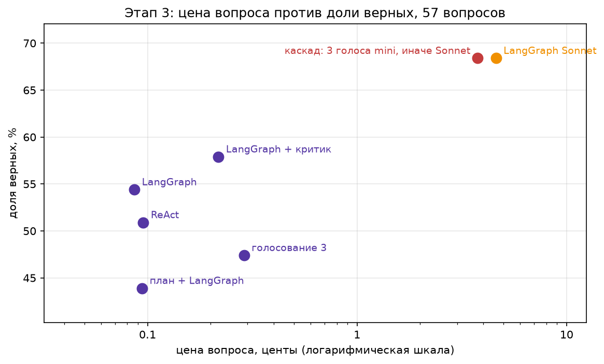

# Агент для вопросов о свежих событиях

Любая языковая модель, даже самая сильная, знает мир только до даты среза своих знаний. Спросите её, сколько людей погибло в аварии в апреле 2026 года, и она либо ответит «не знаю», либо уверенно назовёт неверное число. Размер модели здесь не помогает: нужного факта нет в её весах, его приходится приносить извне - поиском, базой знаний, памятью. Поэтому модели дают инструменты.

Но если факты приносят инструменты, дорогая модель может оказаться лишней. Тезис проекта: **дешёвая модель с хорошими инструментами отвечает на свежие вопросы не хуже сильной, а верный ответ у неё стоит в разы меньше.**

Тезис проверяется на 155 вопросах о событиях 2025-2026 годов, на которые сильная модель без инструментов не отвечает. Главная метрика - цена одного верного ответа: все траты варианта делятся на число его верных ответов.

Агент написан на чистом Python, на третьем этапе для сравнения перенесён на LangGraph. Модели вызываются через [OpenRouter](https://openrouter.ai).

## Этапы

Проект развивается этапами. Каждый этап проверяет новую идею на тех же вопросах и добавляет свои строки в общую таблицу результатов.

| Этап | Идея | Подробности |
|---|---|---|
| 1. ReAct-агент с живым поиском | Дешёвая модель сама ходит в Википедию и на новостные сайты и дочитывает найденную страницу | [docs/01-react-agent.md](docs/01-react-agent.md) |
| 2. RAG и память | Нужные тексты заранее лежат в векторной базе, модель получает пять нужных строк вместо всей страницы. Агент запоминает факты о пользователе, а не носит с собой всю историю диалога | [docs/02-rag-memory.md](docs/02-rag-memory.md) |
| 3. Фреймворк и паттерны | Тот же агент на LangGraph, с критиком, голосованием и каскадом на сильную модель, с планом перед циклом. Сколько стоит каждая надстройка и что она даёт | [docs/03-framework-patterns.md](docs/03-framework-patterns.md) |

## Главное

1. **Без внешних данных размер модели не помогает.** Без инструментов Sonnet отвечает верно на 4 % свежих вопросов, gpt-4o-mini - на 3 % ([этап 1](docs/01-react-agent.md#результаты)).
2. **Точность определяет то, что попадает в контекст модели.** На одной и той же дешёвой модели поиск по Википедии даёт 28 % верных, все источники с чтением страницы - 45 %, готовые абзацы из векторной базы - 89 %. Верный ответ при этом дешевеет с $0.002 до $0.00009 ([этап 1](docs/01-react-agent.md#результаты), [этап 2](docs/02-rag-memory.md#итоговая-таблица)).
3. **Сильная модель при тех же инструментах добавляет несколько пунктов точности за кратно большую цену.** Haiku с живым поиском: 58 % против 49 % на общих вопросах, вопрос в 35 раз дороже ([этап 1](docs/01-react-agent.md#результаты)). Haiku с векторной базой: 92 % против 89 %, в пределах разброса прогонов ([этап 2](docs/02-rag-memory.md#итоговая-таблица)). Sonnet с живым поиском: 68 % против 54 %, верный ответ в 42 раза дороже ([этап 3](docs/03-framework-patterns.md#итоговая-таблица)).
4. **Надстройки над дешёвым агентом не дали прироста сверх разброса прогонов.** Критик добавил 2 верных ответа из 57 при разбросе одинаковых прогонов от 26 до 31, голосование и план результат ухудшили. Фреймворк LangGraph по токенам не дороже голого цикла ([этап 3](docs/03-framework-patterns.md#выводы)).
5. **Сильную модель выгодно звать только там, где дешёвая не уверена.** Согласие трёх прогонов дешёвой модели предсказывает верность: при полном согласии верны 19 ответов из 22, и сильная модель на этих вопросах не лучше. Каскад, который передаёт сильной модели только вопросы с расхождением голосов, даёт её точность на 18 % дешевле ([этап 3](docs/03-framework-patterns.md#голосование-и-каскад)).

## Выбор конфигурации

| Задача | Конфигурация | Основание |
|---|---|---|
| Вопросы по заранее собранному корпусу | RAG на дешёвой модели | 89 % верных, $0.00009 за верный ответ ([этап 2](docs/02-rag-memory.md#итоговая-таблица)) |
| Вопросы вне корпуса, нужен живой поиск | агент на дешёвой модели | самый дешёвый верный ответ на живом поиске: $0.0016 ([этап 3](docs/03-framework-patterns.md#итоговая-таблица)) |
| То же, но ошибка обходится дороже $0.26 | каскад: три прогона дешёвой модели, при расхождении сильная модель | точность сильной модели на 18 % дешевле; каждый верный ответ сверх дешёвого агента стоит $0.26 ([этап 3](docs/03-framework-patterns.md#итоговая-таблица)) |

## Результаты

| этап | вариант | модель | вопросов | доля верных | цена вопроса, $ | цена верного ответа, $ |
|---|---|---|---|---|---|---|
| 1 | без инструментов | claude-sonnet-4.6 | 155 | 0.04 | 0.00221 | 0.05719 |
| 1 | без инструментов | gpt-4o-mini | 155 | 0.03 | 0.00004 | 0.00133 |
| 1 | поиск по Википедии | gpt-4o-mini | 155 | 0.28 | 0.00054 | 0.00196 |
| 1 | все источники + чтение страницы | gpt-4o-mini | 155 | 0.45 | 0.00089 | 0.00200 |
| 1 | все источники + чтение страницы | claude-haiku-4.5 | 57 | 0.58 | 0.03069 | 0.05301 |
| 2 | RAG всегда | gpt-4o-mini | 154 | 0.89 | 0.00008 | 0.00009 |
| 2 | агент с базой знаний | gpt-4o-mini | 154 | 0.90 | 0.00019 | 0.00021 |
| 2 | RAG всегда | claude-haiku-4.5 | 154 | 0.92 | 0.00077 | 0.00083 |
| 3 | ReAct, голый цикл | gpt-4o-mini | 57 | 0.51 | 0.00095 | 0.00188 |
| 3 | LangGraph | gpt-4o-mini | 57 | 0.54 | 0.00087 | 0.00159 |
| 3 | LangGraph + критик | gpt-4o-mini | 57 | 0.58 | 0.00218 | 0.00376 |
| 3 | голосование 3 | gpt-4o-mini | 57 | 0.47 | 0.00289 | 0.00610 |
| 3 | план + LangGraph | gpt-4o-mini | 57 | 0.44 | 0.00094 | 0.00215 |
| 3 | каскад: 3 голоса mini, иначе Sonnet | gpt-4o-mini + claude-sonnet-4.6 | 57 | 0.68 | 0.03765 | 0.05503 |
| 3 | LangGraph | claude-sonnet-4.6 | 57 | 0.68 | 0.04602 | 0.06725 |




Ответы по каждому вопросу лежат в [results/results_raw.csv](results/results_raw.csv), полные записи диалогов агента в `traces/<вариант>/<модель>/<вопрос>.json`. Название варианта начинается с номера этапа и порядкового номера, например `s1-3-поиск все источники + page_find`.

## Ограничения

- **Наборы вопросов на этапах разные:** 155, 154 и 57 вопросов. Сравнивать доли верных стоит внутри одного этапа, число вопросов указано в таблице результатов.
- **Разброс между прогонами.** Один и тот же агент между прогонами расходится на несколько пунктов: 92,9 % и 90,3 % на этапе 2, от 26 до 31 верных из 57 на этапе 3. Разница такого размера между конфигурациями может быть случайной.
- **Автоматическая проверка ответов ошибается.** Среди ответов, которые она сочла неверными, на этапе 3 вручную найдены верные: от 0 до 3 из 10 на конфигурацию. Причины: эталон устарел после правки Википедии, проверка не снимает диакритику, агент отвечает на другом языке ([этап 3](docs/03-framework-patterns.md#валидация-автоматической-оценки)).

## Как запустить

Зависимости ставит [uv](https://docs.astral.sh/uv/): список лежит в `pyproject.toml`, точные версии в `uv.lock`.

```bash
curl -LsSf https://astral.sh/uv/install.sh | sh   # установить uv, если его ещё нет
uv sync                                            # создать .venv и поставить зависимости
cp .env.example .env                               # и вписать ключ OpenRouter: https://openrouter.ai/keys
uv run jupyter lab                                 # открыть ноутбук из папки notebooks/
```

В VS Code или PyCharm выберите `.venv/bin/python` ядром ноутбука. Если ключа в `.env` нет, ноутбук сразу остановится с понятной ошибкой.

Ноутбуки не тратят деньги повторно: если запись диалога по вопросу уже лежит в `traces/`, ответ берётся из неё, а модель не вызывается.

### Векторная база Milvus

Второму этапу нужна векторная база [Milvus](https://milvus.io). Она запускается в Docker одной командой из корня репозитория:

```bash
docker compose up -d        # поднять базу на localhost:19530, первый раз скачивается образ около 1 ГБ
docker compose ps           # подождать, пока статус станет healthy
docker compose down         # остановить, данные сохранятся
docker compose down -v      # остановить и стереть данные
```

Посмотреть коллекции глазами можно в веб-интерфейсе Attu: `docker compose --profile ui up -d`, затем открыть http://localhost:8000.

### Без Docker и в Kaggle

Без Docker подойдёт Milvus Lite: та же база, но живёт в одном файле рядом с ноутбуком и ставится как обычный пакет. Код ноутбука от этого не меняется, меняется только адрес базы.

```bash
uv sync --extra lite                    # поставить Milvus Lite
echo "MILVUS_URI=milvus.db" >> .env     # база будет в файле milvus.db
```

В Kaggle:

1. **Ключ.** В меню редактора **Add-ons → Secrets** добавьте секрет `OPENROUTER_API_KEY`, включите галочку напротив него и перезапустите сессию.
2. **Интернет.** В правой панели **Settings** включите **Internet**. Переключатель работает только после подтверждения телефона в профиле Kaggle.
3. **Данные.** Загрузите содержимое папки `data/` как датасет с именем `ai-agent-events-data` и подключите его к ноутбуку через **Add Input**.
4. **Пакеты и база.** Добавьте в начало ноутбука ячейку:

   ```python
   %pip install -q pymilvus milvus-lite pypdf
   import os
   os.environ["MILVUS_URI"] = "milvus.db"
   ```

## Структура репозитория

```
notebooks/   ноутбуки, по одному на этап
docs/        подробный разбор каждого этапа
data/        вопросы с эталонными ответами и цитатами из источника
scripts/     сборка и проверка набора вопросов
results/     ответы по каждому вопросу и итоговые таблицы
img/         графики, по папке на этап
traces/      полные записи диалогов агента
```
