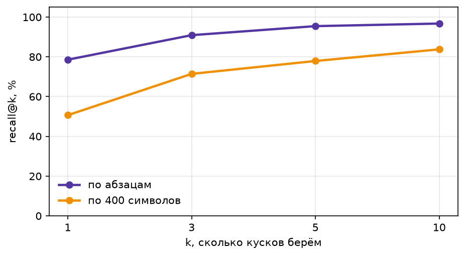
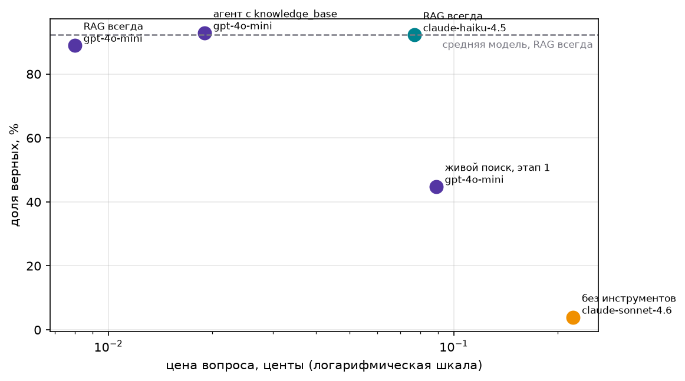
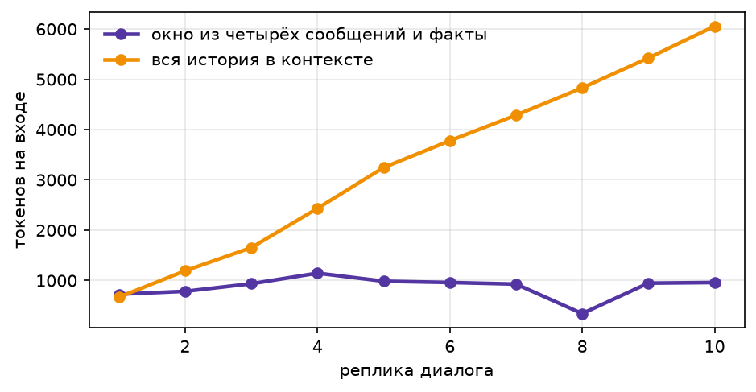
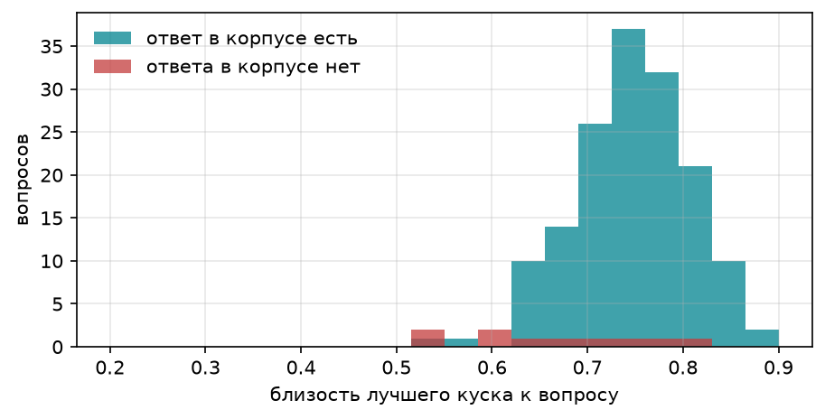

# Этап 2. RAG и память

На первом этапе агент за каждым фактом ходил в интернет: несколько шагов, длинные страницы в контексте, больше половины вопросов без ответа. Здесь нужные тексты заранее лежат в векторной базе, и модель получает несколько подходящих кусков вместо всей страницы.

Всё собрано в ноутбуке [`notebooks/02_rag_memory.ipynb`](../notebooks/02_rag_memory.ipynb).

## Корпус

50 страниц, 1,22 млн символов:

- **28 обзорных страниц английской Википедии про 2026 год** («2026», «2026 in Japan», «2026 in sports» и другие). По ним составлены основные вопросы первого этапа;
- **22 страницы для вопросов по интересам**: статьи английской и русской Википедии, новости GEN и ESPN.

Корпус собирает скрипт [`scripts/fetch_corpus.py`](../scripts/fetch_corpus.py). Он берёт готовые обзорные страницы из `data/corpus_2026.jsonl` и докачивает недостающие. Страницы Википедии скачиваются целиком вместе с таблицами, у новостей берётся только текст статьи. Во всех источниках текст сохраняется одинаково: каждый абзац, пункт списка и строка таблицы на отдельной строке, заголовки разделов в виде `== Раздел ==`.

У каждой страницы есть название и ссылка, у каждого куска - страница, раздел и ссылка, по которым человек найдёт источник.

## Вопросы

**154 вопроса с ответом** из первого этапа (`data/fresh_2026.jsonl`). У каждого есть цитата `evidence` - строка из корпуса, в которой лежит ответ. По ней определяется верный кусок при оценке поиска.

При сборке корпуса цитата не нашлась у 10 вопросов из 155. Девять исправлены так, что вопрос и ответ остались прежними: пересказанная цитата заменена на дословную строку, а у двух вопросов исправлена страница. `fresh-6` исключён: Википедия обновила цифры, и эталонный ответ устарел. Подробности в ноутбуке, раздел «Проверка цитат».

**10 вопросов без ответа** (`data/unanswerable_2026.jsonl`): по темам корпуса, но о том, чего в нём нет. Они двух видов, по пять:

- **ответа нет в корпусе, но он есть в мире**, например сколько Chai Discovery привлекла в раунде Series C. Система, которая отвечает по корпусу, должна отказаться, а агент с живым поиском может найти ответ;
- **ответа нет нигде**, например премия Тьюринга за 2026 год. Отказаться должна любая система.

При первой разметке один вопрос оказался неудачным: «Which feature film won the Cristal award at the 2026 Annecy festival?» был помечен «ответа в корпусе нет», но на странице «2026 in animation» в списке наград есть строка «Annecy International Animation Film Festival Cristal du long métrage: Paper Trail». Наличие ответа проверялось вручную, и строку на французском в общем списке премий пропустили. Вопрос заменён на «Who won the 2026 Indianapolis 500?» (Felix Rosenqvist): в корпусе Индианаполис встречается только как город. Теперь в ноутбуке для каждого вопроса без ответа выводится ближайший кусок корпуса, и такая ошибка видна сразу.

## Нарезка

| Нарезка | Кусков | Как режет |
|---|---|---|
| наивная | 3072 | по 400 символов, не глядя на границы |
| по абзацам | 7282 | одна строка текста - один кусок, заголовок раздела в метаданных |

**Почему по абзацам:** абзац, пункт списка или строка таблицы - законченная мысль автора, и кусок не обрывает факт на середине.

Строки из 40 символов и короче выбрасываются: это даты-подзаголовки вроде «August 26», подписи и пункты меню. Проверка показала, что ни один вопрос из-за этого не теряет верный кусок. Длинные абзацы не делятся, кусков длиннее 800 символов 1,1 %.

## Эмбеддинги

Модель `text-embedding-3-small`, вектор укорочен до 512 чисел. Кэш лежит в `data/embeddings_512.npz`: ключ - хэш текста, значение - вектор. Недостающие тексты досчитываются пачками по 64 и дописываются в тот же файл. Первый запуск досчитал 2,7 тысячи текстов с новых страниц за $0.0046, повторный запуск не платит ничего.

## Качество поиска

`recall@k` - доля вопросов, у которых верный кусок попал в первые k найденных.

**Какой кусок считается верным.** Кусок с той же страницы, что и цитата `evidence`, в котором есть ответ (у ответа из нескольких частей - каждая часть) и хотя бы половина слов цитаты. Порог 0.5 выбран из здравого смысла. Ограничение: тот же факт на другой странице не засчитывается. В `fresh-138` поиск первым приносит кусок «18 March - Charles H. Bennett and Gilles Brassard are awarded the 2025 Turing Award…» со страницы «2026 in science», а цитата взята со страницы «Turing Award» и написана другими словами: совпадают 10 слов из 24, порог кусок не проходит. Снять требование страницы нельзя: цитаты написаны в стиле новостной ленты, и без проверки страницы порог проходят 107 кусков с других страниц, например заметки о землетрясениях в Венесуэле и Японии на вопрос о землетрясении в Герреро. Точное решение - ручная разметка: заранее отметить для каждого вопроса все куски с ответом.

| k | 1 | 3 | 5 | 10 |
|---|---|---|---|---|
| по абзацам | 0.79 | 0.91 | 0.95 | 0.97 |
| по 400 символов | 0.51 | 0.71 | 0.78 | 0.84 |

Нарезка по абзацам находит верный кусок первым в 79 % вопросов против 51 % у наивной, и это ничего не стоит: те же тексты, другие границы. Название страницы, которое приклеено только к абзацам, даёт из этого разрыва не больше 5 пунктов, см. «Честное сравнение нарезок» ниже.

**Выбор k:** берём k = 5. При пяти кусках верный находится у 95 % вопросов, а десять кусков добавляют чуть больше процента ценой вдвое большего контекста.

## Гибрид: поиск по словам и RRF

Recall@1 / recall@5:

| Нарезка | только вектор | только слова | гибрид RRF |
|---|---|---|---|
| по 400 символов | 0.51 / 0.78 | 0.69 / 0.84 | 0.68 / 0.84 |
| по абзацам | 0.79 / 0.95 | 0.83 / 0.93 | 0.83 / 0.97 |

**Честное сравнение нарезок.** В кривой recall@k абзацы эмбеддятся вместе с названием страницы («2026 in Japan: …»), а окна по 400 символов без него. Чтобы отделить вклад названия от вклада границ, обе нарезки посчитаны в обоих вариантах, и для вектора, и для поиска по словам. Recall@1 / recall@5:

| Нарезка | Текст | вектор | слова | гибрид RRF |
|---|---|---|---|---|
| по 400 символов | с названием страницы | 0.56 / 0.79 | 0.73 / 0.88 | 0.68 / 0.87 |
| по 400 символов | без названия | 0.51 / 0.78 | 0.69 / 0.84 | 0.68 / 0.84 |
| по абзацам | с названием страницы | 0.79 / 0.95 | 0.83 / 0.93 | 0.83 / 0.97 |
| по абзацам | без названия | 0.78 / 0.92 | 0.75 / 0.92 | 0.84 / 0.95 |

Вектору название почти не помогает: у абзацев recall@1 0.79 против 0.78, у окон 0.56 против 0.51. Разрыв между нарезками держится и без названия (0.78 против 0.51), значит основной выигрыш дают границы абзацев, а не заголовок. Поиску по словам название помогает заметнее: у абзацев recall@1 0.83 против 0.75. Вероятно, в вопросе часто есть название страны или события, которое в самом абзаце не повторяется. Основной конвейер оставляем с названием страницы: вектору оно не мешает, а поиску по словам и гибриду помогает.

## Milvus

Коллекция нарезки по абзацам, 7282 куска, рядом с вектором страница, раздел, ссылка и текст. Milvus поднимается из `docker-compose.yml` в Docker. Фильтр `page == "2026 in Japan"` на вопросе о землетрясении в Яманаси оставляет только японские землетрясения. Выдача почти полностью совпадает с точным перебором на numpy: индекс HNSW ищет приближённо.

## Итоговая таблица

154 вопроса. Ответ проверяется той же функцией, что на первом этапе. Эталон из нескольких частей через запятую проверяется по частям: при эталоне «Charles H. Bennett, Gilles Brassard» ответ «Charles H. Bennett and Gilles Brassard» засчитывается. Части, соединённые через «and», не делятся: так пишутся и названия («Clara and the Below»), а ответ-список с лишними пунктами засчитывать нельзя.

| Вариант | Модель | Доля верных | Цена вопроса, $ | Цена верного ответа, $ |
|---|---|---|---|---|
| сильная модель без инструментов (этап 1) | claude-sonnet-4.6 | 0.039 | 0.00222 | 0.05696 |
| дешёвая модель, живой поиск (этап 1) | gpt-4o-mini | 0.448 | 0.00089 | 0.00200 |
| дешёвая модель, RAG всегда | gpt-4o-mini | 0.890 | 0.00008 | 0.00009 |
| дешёвая модель, агент с `knowledge_base` | gpt-4o-mini | 0.903 | 0.00019 | 0.00021 |
| средняя модель, RAG всегда | claude-haiku-4.5 | 0.922 | 0.00077 | 0.00083 |

Дешёвый агент с базой знаний и средняя модель с RAG по точности вровень (90,3 % против 92,2 %), а верный ответ у агента в 4 раза дешевле. Самый дешёвый верный ответ у дешёвой модели с «RAG всегда»: $0.00009 при 89,0 % верных. По сравнению с прошлым этапом верный ответ дешёвого агента подешевел в 10 раз, а доля верных выросла с 45 % до 90 %: модель получает пять нужных кусков вместо длинных страниц и делает меньше шагов.

**Разброс между прогонами.** Тот же агент с той же логикой в прошлом прогоне ответил верно на 92,9 % вопросов, в этом - на 90,3 %, хотя `temperature = 0`: на развилке модель иначе пишет запрос, находит другое, и дальше всё идёт иначе. Поэтому разница в 2-3 процентных пункта между вариантами - в пределах шума.

## Разбор провалов

Разбираем агента с `knowledge_base` на дешёвой модели: он единственный ищет сам, и в его трейсах видны все запросы и найденные куски. 15 ошибок из 154. В 11 из них верного куска нет ни в одном из найденных агентом, в 4 кусок был, но ответ неверный. У «RAG всегда» на той же модели наоборот: 6 и 11. Причина может быть в запросах: агент ищет не по вопросу, а по запросу, который пишет сам, и в 8 из 11 провалов поиска полный вопрос нужный кусок находил. Пример `fresh-8`: вопрос «Who was charged by the FSB in Russia on 29 July 2026?», агент искал «FSB charges July 29 2026» и ответил `NOT_FOUND`, а «RAG всегда» по полному вопросу нашёл кусок с ответом (Pavel Durov). Короткий набор ключевых слов подходит для поиска по словам, а вектору нужен смысл всей фразы. Вероятно, сокращать вопрос агента подталкивает описание инструмента («short search query: names, dates, key terms»). **Что менять:** просить в описании запрос полной фразой или искать сразу по запросу и по исходному вопросу и сливать выдачи через RRF.

**Поиск не нашёл: `fresh-2`.** Вопрос: «Who entered negotiations with the Trump administration on March 13, 2026?», эталон - Miguel Díaz-Canel. Агент искал 5 раз, из них 3 раза с фильтром по странице «2026 in the United States», и нашёл 14 разных кусков - все с этой страницы, в основном про переговоры Трампа с Ираном: в вопросе нет слова «Cuba», и вектор тянется к самой частой теме корпуса. Нужный кусок лежит на странице «2026 in politics» и начинается с «March 13 - First Secretary of the Communist Party of Cuba…». Агент ответил `NOT_FOUND`, «RAG всегда» по полному вопросу этот кусок тоже не нашёл. **Что менять: запрос и поиск.** Дата «March 13» в вопросе - точный признак: поиск по словам в гибриде или фильтр по разделу `section == "March"` поднимут нужный кусок.

**Нашёл, но ответ неверный: `fresh-29`.** Вопрос: «How many people were killed in the train derailment near Adamuz, Spain, in January 2026?», эталон - 43. Агент искал один раз, и в выдаче три куска про ту же аварию: на странице «2026» - 46 погибших, на «2026 in Spain» - 43, на «2026 in rail transport» - 46. Модель взяла первый кусок и ответила 46. Страницы Википедии обновлялись в разное время и расходятся в цифрах. **Что менять: промпт и проверку ответа.** Промпт должен просить при противоречии источников назвать оба числа, а эталон такого вопроса - принимать оба значения или помечать вопрос как спорный.

## Память

Своей памяти у модели нет: между сессиями она знает только то, что код положит ей в контекст. Агент с `knowledge_base` получает две памяти. **Эпизодическая** - журнал всех реплик в `logs/episodes.jsonl` с сессией и временем; в контекст он не идёт. **Семантическая** - короткие факты о пользователе. В конце сессии дешёвая модель получает известные факты и диалог и возвращает обновлённый список целиком, поэтому отменённый факт заменяется, а не ложится рядом. Факты лежат в отдельной коллекции Milvus `facts`, к каждой реплике три ближайших попадают в системный промпт. В контексте агента: системный промпт с фактами, окно из двух последних пар реплик и новая реплика. Журнал и факты - личные данные, папка `logs/` в `.gitignore`; журнал показан в ноутбуке.

**Две сессии.** В первой Лена рассказывает о себе: продуктовый аналитик из Новосибирска, следит за космосом и хоккеем. После сессии в памяти пять фактов. Во второй сессии история первой в контекст не попадает. На «Что интересного случилось в моих темах за лето?» агент раскладывает ответ по космосу и хоккею: темы он знает только из фактов. Сами события подобраны неудачно (под космосом сделка SpaceX с Cursor, хоккей за март). Причина может быть той же, что в разборе провалов: агент ищет короткими запросами. Затем Лена говорит, что бросила хоккей ради футбола и переехала в Калининград. После сессии в памяти «Город: Калининград» и «Интересы: космос, футбол» вместо прежних фактов. На саму реплику о переезде агент сходил в базу, хотя промпт просит не искать на рассказы о себе, и выдал «новости футбола», где оказалась велогонка. На факты это не повлияло, но лишний поиск стоит денег.

**Тесты без модели** проверяют запись и поиск фактов: пустая память ничего не возвращает; по вопросу «Где я живу?» находится «Город: Новосибирск»; после замены списка находится «Город: Калининград», а Новосибирска в памяти нет. Тесты проверяют код памяти, а не модель. Поймёт ли модель, что новый факт отменяет старый, и учтёт ли факты в ответе, показывает только демонстрация из двух сессий, а это один пример, а не гарантия.

**Токены.** Диалог из 10 вопросов двумя способами:

| Способ | Токенов на входе | Цена, $ |
|---|---|---|
| окно из четырёх сообщений и факты | 8 720 | 0.00168 |
| вся история в контексте | 33 571 | 0.00351 |

Со всей историей вход растёт с каждой репликой: в контекст снова идут прошлые вопросы, вызовы инструмента и найденные куски. С окном и фактами вход почти не растёт: за 10 реплик в 3,9 раза меньше токенов. Цена диалога ниже в 2,1 раза, меньше, чем токены: кроме входа, платим за ответы модели, а их окно не сокращает.

Ответы модели в диалогах сохраняются в `traces/s2-4-память/`: повторный запуск ноутбука берёт их оттуда, не платит и даёт те же цифры.

## Отказы

Система, которая отвечает по корпусу, должна честно отказаться (`NOT_FOUND`), если ответа в корпусе нет, и не отказываться, если он есть.

| Вариант | Модель | Отказал, ответ есть в мире (из 5) | Отказал, ответа нет нигде (из 5) | Отказал зря (из 154 с ответом) |
|---|---|---|---|---|
| средняя модель, RAG всегда | claude-haiku-4.5 | 5 | 5 | 8 |
| дешёвая модель, RAG всегда | gpt-4o-mini | 5 | 5 | 14 |
| дешёвая модель, агент с `knowledge_base` | gpt-4o-mini | 5 | 5 | 8 |
| сильная модель без инструментов | claude-sonnet-4.6 | 4 | 4 | - |

Все три варианта с базой знаний отказываются на всех 10 вопросах без ответа: поиск приносит куски не о том, и модель это видит. Сильная модель без инструментов на `none-2` выдумала ответ: город финала ICPC 2026 «Astana, Kazakhstan», на самом деле Дубай. На `none-9` она по смыслу отказалась («премия 2026 года ещё не присуждена»), но не в формате `NOT_FOUND`. Отказ проверяется строго по формату, одинаково для всех вариантов. Варианты различаются лишними отказами: «RAG всегда» на дешёвой модели отказывается на 14 вопросах из 154, где ответ есть, а Haiku и агент - на 8.

**Отказ без вызова модели по порогу близости не работает.** Идея: если даже самый близкий кусок мало похож на вопрос, ответа в корпусе, скорее всего, нет, и можно отказать сразу, не тратя деньги на модель. В среднем это так: близость лучшего куска у вопросов без ответа 0.665, у вопросов с ответом 0.751. Но разброс большой: чтобы порог отсёк все 10 вопросов без ответа, под него попадут и 121 из 154 вопросов с ответом. Отказ лучше оставить модели: она видит, есть ли ответ в найденных кусках.

